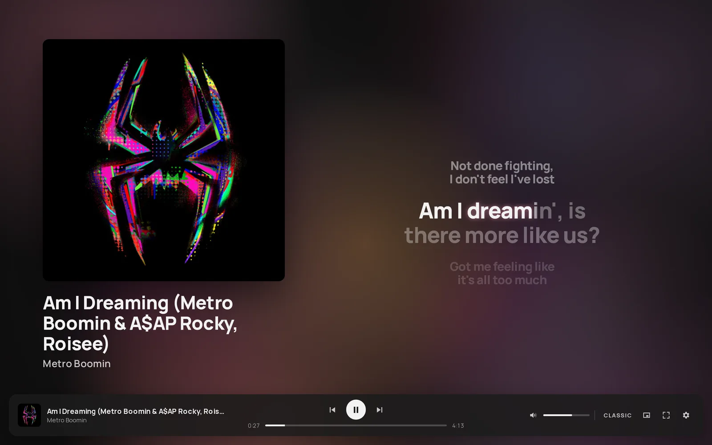
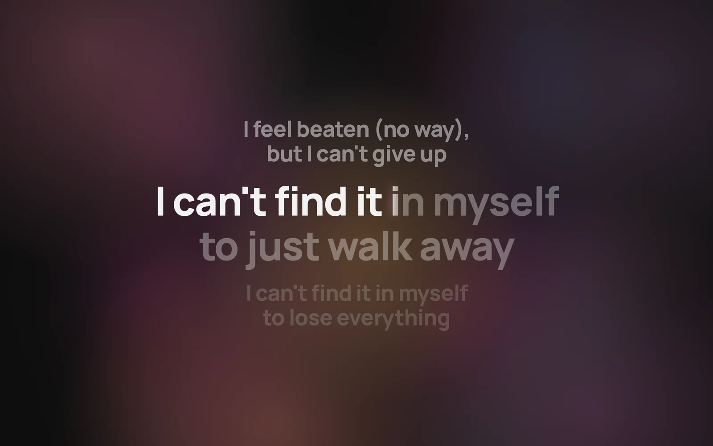
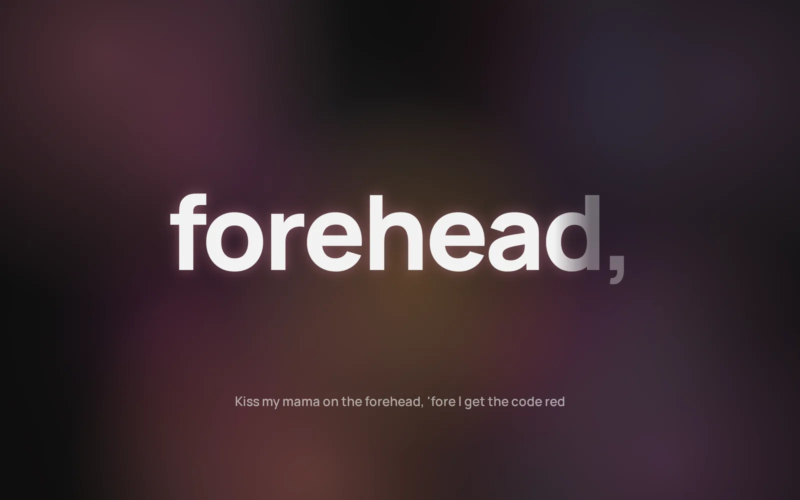
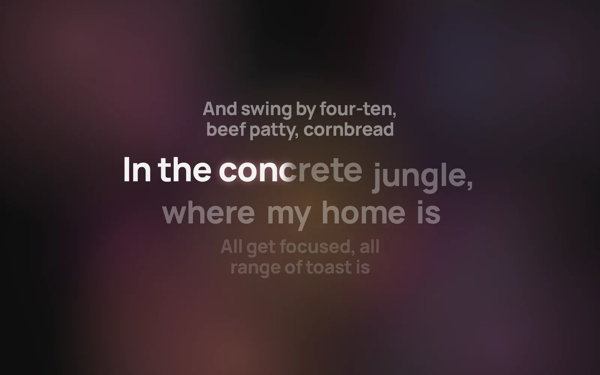
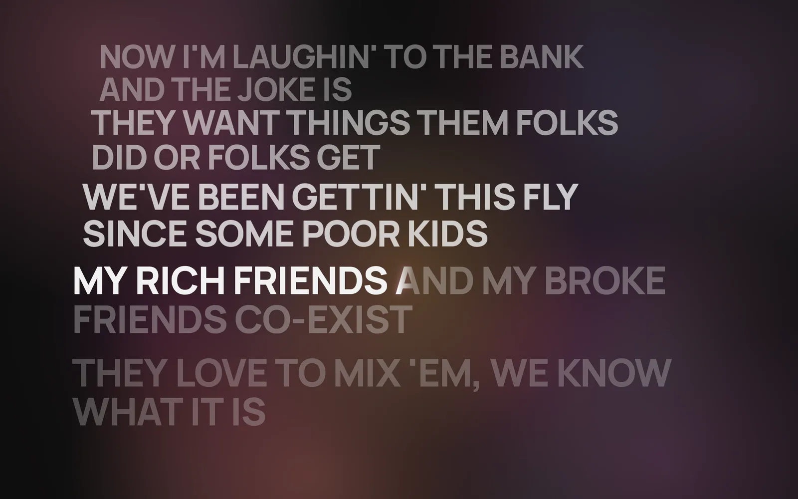
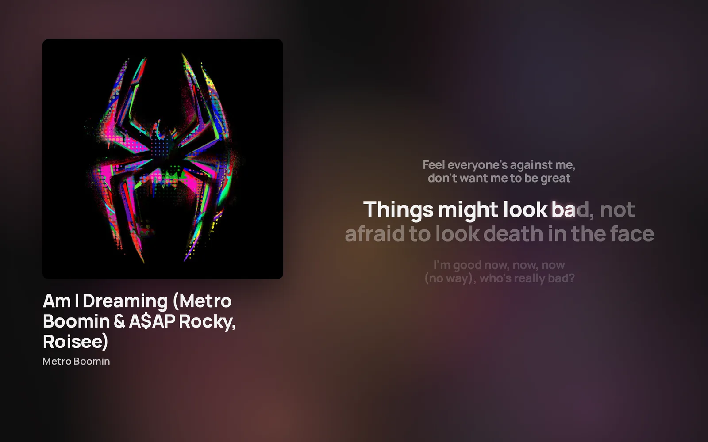
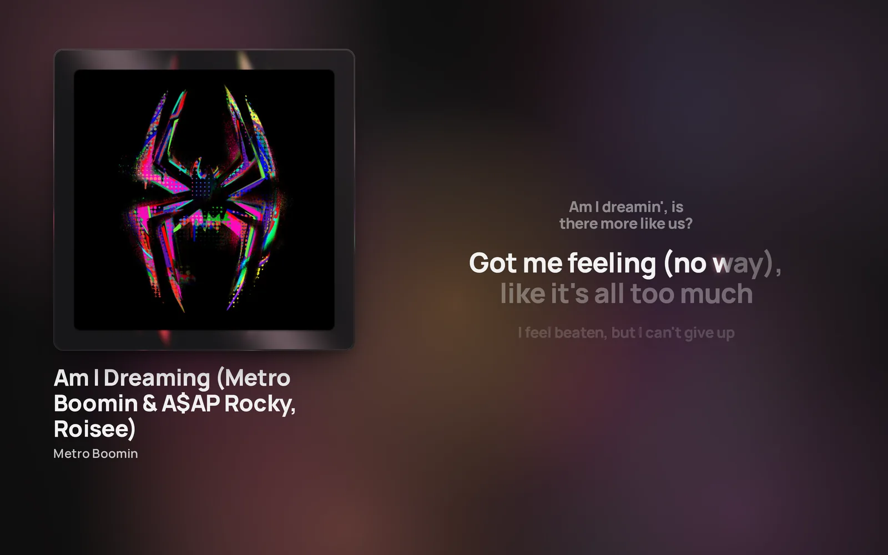
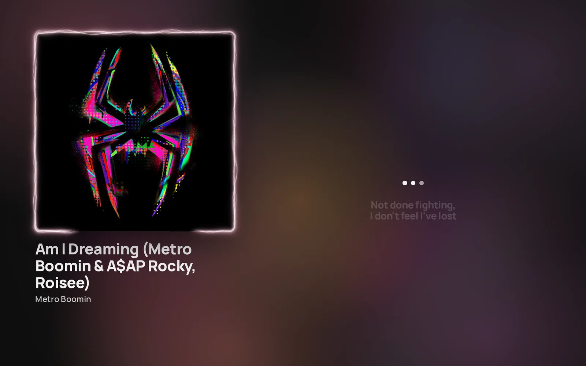
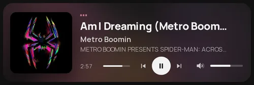
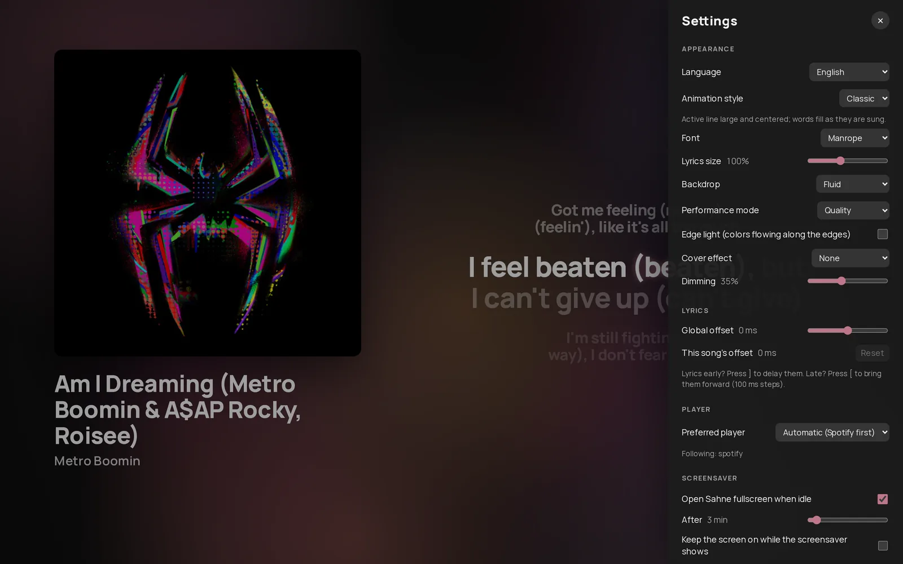

# Sahne

**English** · [Türkçe](README.tr.md)

[](https://github.com/Tosyaliemir/sahne/actions/workflows/ci.yml)
[](https://codecov.io/gh/Tosyaliemir/sahne)
[](https://github.com/Tosyaliemir/sahne/releases)
[](#licence-and-disclaimers)


Sahne shows synchronized, word-by-word animated lyrics for the song playing in
Spotify or any other desktop music player, over a backdrop made from the
album artwork's colors.



## Features

- Synchronized lyrics from [LRCLIB](https://lrclib.net), animated word by
  word, in six styles.
- A backdrop generated from the album artwork, plus optional cover effects and
  an edge glow.
- Works with Spotify and any player that reports to the system's media
  controls (MPRIS on Linux, media sessions on Windows). No Spotify account,
  API key or Premium subscription is needed.
- Mini player, screensaver mode, per-track timing correction and an offline
  cache.
- Linux (Wayland and X11; GNOME and KDE Plasma) and Windows 10 and 11.
- English and Turkish interface, following the system language.

## Installation

Prebuilt packages are published on the
[Releases](https://github.com/Tosyaliemir/sahne/releases) page. No release
has been published yet; until then, [build from source](#building-from-source).

Each release provides:

- **Linux, AppImage (any distribution):**
  `chmod +x Sahne_*.AppImage && ./Sahne_*.AppImage`
- **Linux, .deb (Debian, Ubuntu):** `sudo apt install ./Sahne_*.deb`
- **Windows:** run `Sahne_<version>_x64-setup.exe`. It installs for the current
  user without administrator rights. The installer is not code-signed yet, so
  SmartScreen may show "Windows protected your PC"; choose **More info → Run
  anyway**.

Every release lists SHA-256 checksums (`SHA256SUMS`) and carries a build
provenance attestation (`gh attestation verify <file> --repo Tosyaliemir/sahne`).

## Usage

Start playing a song in Spotify (or another player), then start Sahne. Within
a moment it picks up the track, finds the lyrics and sets the scene. By
default the cover and the lyrics share the screen; click the lyrics or press
`L` to give them the whole screen, then click a line to seek to it.

| Key         | Action                                                         |
| ----------- | -------------------------------------------------------------- |
| `Space`     | Play / pause                                                   |
| `←` / `→`   | Previous / next track                                          |
| `↑` / `↓`   | Volume up / down (where the player supports it)                |
| `L`         | Lyrics focus: lyrics fill the screen / back to the split view  |
| `S`         | Next lyrics style                                              |
| `[` / `]`   | Show this song's lyrics 100 ms earlier / later (remembered)    |
| `F` / `Esc` | Toggle fullscreen / leave fullscreen                           |
| `M`         | Mini player (small, always on top where the desktop allows it) |
| `,`         | Settings                                                       |

The progress bar is clickable. The bottom bar hides after two seconds without
mouse movement (configurable).

## Lyrics styles

| Classic                                                                                                              | Kinetic                                                                                                  |
| -------------------------------------------------------------------------------------------------------------------- | -------------------------------------------------------------------------------------------------------- |
|  |  |
| **Wave**                                                                                                             | **Wall**                                                                                                 |
|                                  |                         |

- **Classic:** the active line is large and centred; words fill from left to
  right as they are sung, with a slight lift and glow.
- **Kinetic:** each word appears on its own in the middle of the screen.
- **Minimal:** no motion, only the color fill. Chosen automatically when the
  system asks for reduced motion.
- **Wave:** the Classic layout, with words rising into place one after another.
- **Blend:** Classic, switching to Kinetic for fast passages (more than about
  3.4 words per second for at least 3.5 seconds) and back.
- **Wall:** recent lines stack into a wall of large type that sways gently in
  3D.

Most LRCLIB lyrics are timed per line. Without word timings (Enhanced LRC), a
line's duration is spread over its words by length, so word highlighting is an
estimate while line changes are exact.

## Backdrops and cover effects

| Blurred backdrop                                                                                            | Metal plate                                                                                           |
| ----------------------------------------------------------------------------------------------------------- | ----------------------------------------------------------------------------------------------------- |
|  |        |
| **Electric border**                                                                                         | **Mini player**                                                                                       |
|                     |  |

Backdrops (Settings → Appearance → Backdrop):

- **Fluid** (default): the cover itself, slowly flowing and swirling (WebGL),
  blended with five colors taken from it. Falls back to Blurred without WebGL,
  and on software rendering unless the performance mode is Quality.
- **Blurred:** a pre-blurred copy of the cover with drifting color fields.
- **Original cover:** the sharp cover, slowly zooming and darkened for
  readability.
- **Color:** a calm gradient made from the cover's colors.

**Performance mode** limits the fluid backdrop: _Auto_ (30 fps, lower
resolution when frames run late), _Quality_ (full rate) and _Battery saver_
(20 fps, lower resolution). A paused or hidden window draws nothing.

Cover effects (Settings → Appearance → Cover effect) take their colors from
the cover:

- **Metal plate:** the cover is set into a brushed metal plate that reflects
  it and tilts toward the mouse.
- **Electric border:** light crackles along the cover's edge; it sparks when
  the mouse comes near and sends a pulse on click.

Both need WebGL2. They are turned off when the system asks for reduced motion.
When it asks for more contrast, the electric border glows and flickers less and
the metal plate drops its moving highlights; in Battery saver mode the electric
border draws at 30 fps without sparks and the plate renders at 1x resolution.
**Edge light** adds colors flowing along the screen edges.



_Screenshots show lyrics and artwork for illustration only; all rights belong
to their owners._

## Screensaver mode

When music plays and the computer has been idle for a while (3 minutes by
default), Sahne comes to the front in fullscreen. Moving the mouse or pressing
a key puts the windows back as they were (hidden, minimised, mini player…).
The delay is configurable, and the mode can be turned off. Optionally, Sahne
keeps the screen from blanking while it shows; this also delays the system's
lock screen, so it is off by default.

Idle time comes from `ext-idle-notify` on Wayland compositors that support it
(tested on KDE Plasma 6), otherwise from GNOME's Mutter IdleMonitor or the
`org.freedesktop.ScreenSaver` D-Bus interface on X11, and from the last input
time on Windows. Sleep inhibitors set by music players are ignored, so the
mode works while music plays.

## Configuration and data locations

Settings are changed in the settings panel (`,`). The files are plain JSON.

| Contents                                 | Linux                           | Windows                                |
| ---------------------------------------- | ------------------------------- | -------------------------------------- |
| Settings                                 | `~/.config/sahne/settings.json` | `%APPDATA%\sahne\config\settings.json` |
| Per-track lyric offsets                  | `~/.config/sahne/offsets.json`  | `%APPDATA%\sahne\config\offsets.json`  |
| Lyrics cache (misses retried after 24 h) | `~/.cache/sahne/lyrics/`        | `%LOCALAPPDATA%\sahne\cache\lyrics\`   |
| Artwork and backdrop cache               | `~/.cache/sahne/art/`           | `%LOCALAPPDATA%\sahne\cache\art\`      |

The caches are capped at 20 MB (lyrics) and 200 MB (artwork) and are safe to
delete; Settings → Window → Cache shows their size and clears them.

## Troubleshooting and known limitations

- **NVIDIA on Wayland:** WebKitGTK's GPU renderer crashes with "Error 71"
  because of NVIDIA's explicit sync. Sahne sets `__NV_DISABLE_EXPLICIT_SYNC=1`
  when it detects the NVIDIA driver, which keeps GPU rendering and 60 fps.
  (The often suggested `WEBKIT_DISABLE_DMABUF_RENDERER=1` also avoids the crash
  but copies frames through the CPU and stutters in fullscreen.) If you set the
  variable yourself, Sahne leaves it alone.
- **Mini player on GNOME Wayland:** GNOME does not let applications keep a
  window on top, and no Wayland compositor lets them restore a window's
  position. "Always on top" works on KDE Plasma; positions are restored on X11.
- **LRCLIB coverage:** LRCLIB is a free, community-maintained service. Some
  songs are missing or slightly out of sync (use `[` and `]`), and coverage of
  non-English songs is lower. Sahne spaces its requests, backs off when the
  service is busy, and retries in the background.
- **Volume on Windows:** Windows media sessions do not expose the player's
  volume, so the volume control is hidden there.
- **Players that report position 0:** some players always report position 0.
  Sahne notices within three seconds, counts time itself, and shows a note in
  the settings. Seeking from Sahne stays accurate in this mode; seeking in the
  player may drift until the next track.

To check what a player reports on Linux, use `playerctl`:

```sh
playerctl -l                    # connected players
playerctl -p spotify metadata   # title, artist, artwork URL, length
playerctl -p spotify position   # should increase while playing
```

For a detailed log, start Sahne with `RUST_LOG=sahne_lib=debug`.

## Building from source

You need Rust (the pinned version in `rust-toolchain.toml` is installed by
`rustup`), Node.js 22, pnpm 10 and the platform's WebView development files;
see [CONTRIBUTING.md](CONTRIBUTING.md#development-setup) for the package lists.

```sh
pnpm install
pnpm tauri build                      # Linux: AppImage and .deb
pnpm tauri build --bundles nsis       # Windows: installer
```

The packages are written to `src-tauri/target/release/bundle/`.

## Development

```sh
pnpm tauri dev                       # run with hot reload
pnpm lint && pnpm check && pnpm test # frontend: ESLint/Prettier, types, unit tests
cd src-tauri && cargo test           # backend tests
```

- **Mock player:** `dev-tools/mock-player` publishes a fake MPRIS player for
  testing without Spotify; run Sahne with `SAHNE_PLAYER=sahnemock`.
- **Preview harness:** `preview.html` renders the UI in a normal browser with a
  mocked backend (`pnpm vite --port 1430`, then open
  `http://127.0.0.1:1430/preview.html`). `pnpm screenshots` regenerates the
  images in this README.

See [CONTRIBUTING.md](CONTRIBUTING.md) for details, including the
[manual test checklist](CONTRIBUTING.md#manual-test-checklist).

## Architecture

A Rust backend (Tauri 2) follows the media player, fetches lyrics and artwork,
and sends events to a Svelte 5 frontend. See
[docs/ARCHITECTURE.md](docs/ARCHITECTURE.md) for the services, the event
contract, the threading model and the cache layout.

## Contributing

Bug reports, translations and pull requests are welcome. Please read
[CONTRIBUTING.md](CONTRIBUTING.md) and the
[Code of Conduct](CODE_OF_CONDUCT.md).

## Security

Please report vulnerabilities privately; see [SECURITY.md](SECURITY.md), which
also describes the threat model.

## Credits and acknowledgements

- [React Bits](https://reactbits.dev) by David Haz: the electric border and
  metal plate effects are derived from its "Electric Border" and "Reflective
  Card" components (MIT + Commons Clause; see
  [THIRD_PARTY_NOTICES.md](THIRD_PARTY_NOTICES.md)).
- [LRCLIB](https://lrclib.net): the lyrics database and API.
- [Manrope](https://github.com/googlefonts/manrope): the bundled typeface (SIL
  Open Font License 1.1).
- [Tauri](https://tauri.app) and [Svelte](https://svelte.dev): the application
  framework and the UI framework.
- Apple Music and [AMLL](https://github.com/amll-dev/applemusic-like-lyrics):
  visual inspiration for the fluid backdrop. No code was taken from either.

## Licence and disclaimers

Sahne is MIT-licensed (see [LICENSE](LICENSE)), except for the third-party files
listed in [THIRD_PARTY_NOTICES.md](THIRD_PARTY_NOTICES.md), which keep their own
licences. Because two effect modules are under MIT + Commons Clause, Sahne as a
whole is not purely OSI-approved open source. Settings → About lists the
licences of all bundled dependencies.

Sahne is not affiliated with or endorsed by Spotify. Spotify is a trademark of
Spotify AB.

Lyrics are community-provided by LRCLIB and remain the property of their
respective rights holders; Sahne only displays and caches them locally.

Screenshots show lyrics and artwork for illustration only; all rights belong to
their owners.
