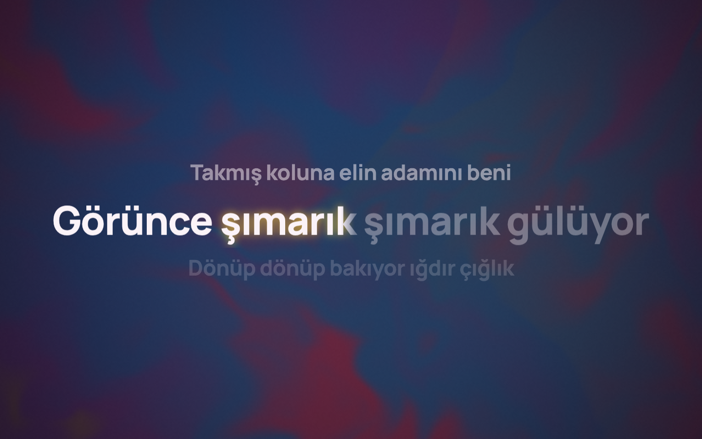
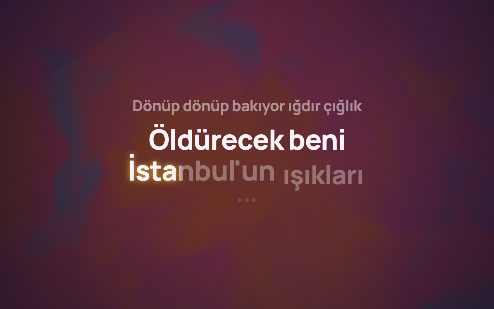
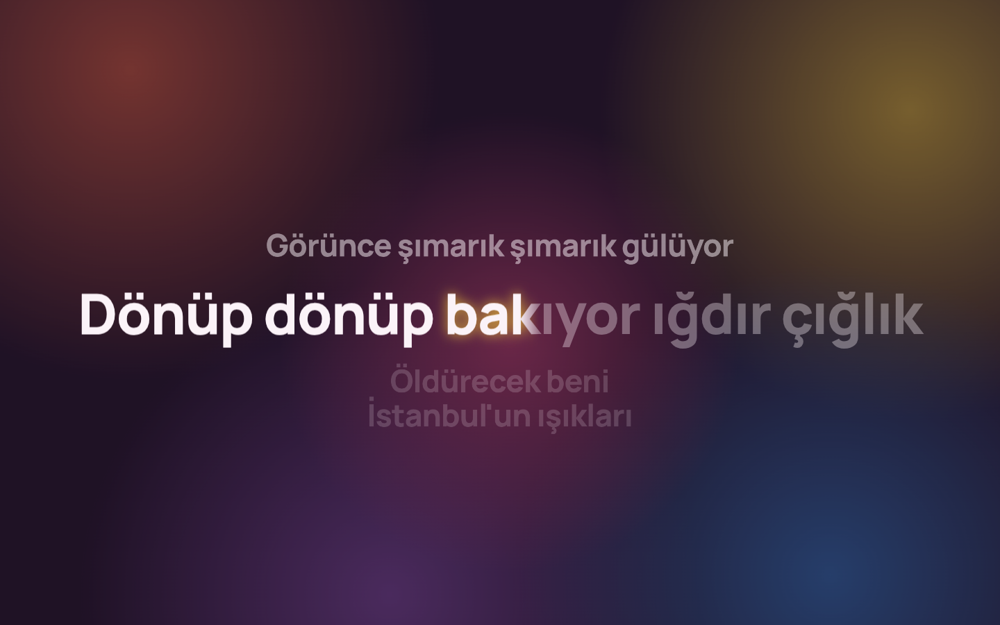
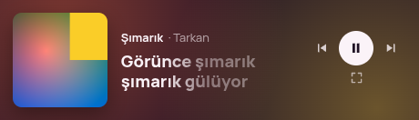

# Sahne

[](https://github.com/OWNER/sahne/actions/workflows/ci.yml)

Spotify'da (veya sistemin medya kontrollerine bağlanan başka bir oynatıcıda) çalan şarkının sözlerini **senkronize ve kelime kelime animasyonlu** olarak tam ekranda gösteren, ekranı albüm kapağının renklerine büründüren bir masaüstü uygulaması. **Linux** ve **Windows** için.



| Dalga stili | Bulanık arka plan |
|---|---|
|  |  |

Mini mod: 

- Spotify Web API, hesap, anahtar veya Premium **gerekmez**: oynatıcı bilgisi sistemden okunur (Linux'ta D-Bus/MPRIS, Windows'ta sistem medya kontrolleri — ses düğmesine basınca çıkan medya kutusunun kaynağı).
- Sözler ücretsiz ve anahtarsız [LRCLIB](https://lrclib.net)'ten gelir, diskte önbelleğe alınır.
- Linux'ta Wayland ve X11'de çalışır; GNOME ve KDE hedeflenmiştir. Windows 10 ve 11'de çalışır.

## Kurulum

En kolayı [Releases](https://github.com/OWNER/sahne/releases) sayfasından indirmek:

- **Windows:** `Sahne_<sürüm>_x64-setup.exe` dosyasını indirip çalıştır. Yönetici izni istemez; Başlat menüsüne eklenir. (İmzasız olduğu için SmartScreen "Windows bilgisayarınızı korudu" diyebilir: **Ek bilgi → Yine de çalıştır**.)
- **Linux, AppImage (her dağıtım):** `chmod +x Sahne_*.AppImage && ./Sahne_*.AppImage`
- **Linux, .deb (Debian/Ubuntu):** `sudo apt install ./Sahne_*.deb`

Kaynaktan derlemek için aşağıdaki "Geliştirme" bölümüne bak; `pnpm tauri build` iki paket üretir:

- `src-tauri/target/release/bundle/appimage/Sahne_<sürüm>_amd64.AppImage` — tek dosya, kurulum gerektirmez (`chmod +x` ile çalıştır).
- `src-tauri/target/release/bundle/deb/Sahne_<sürüm>_amd64.deb` — `sudo apt install ./Sahne_*.deb`.

Windows'ta `pnpm tauri build --bundles nsis` kurulum dosyasını `src-tauri/target/release/bundle/nsis/` altına üretir (Rust, Node.js ve Visual Studio C++ Build Tools gerekir).

## Kullanım

Spotify'ı açıp bir şarkı çal, Sahne'yi başlat. Birkaç yüz milisaniye içinde şarkıyı tanır, sözleri bulur ve sahneyi kurar.

| Tuş | İşlev |
|---|---|
| `Boşluk` | Oynat / duraklat |
| `←` / `→` | Önceki / sonraki şarkı |
| `F` / `Esc` | Tam ekran / tam ekrandan çık |
| `M` | Mini mod (küçük, her zaman üstte pencere) |
| `S` | Animasyon stilini değiştir: **Klasik → Kinetik → Sade → Dalga → Harman** |
| `[` / `]` | Bu şarkının sözlerini 100 ms öne al / geciktir (kalıcı) |
| `,` | Ayarlar |

Söz satırına tıklamak şarkıyı o satıra sarar; alt çubuktaki ilerleme çubuğu da tıklanabilir. Fare 2 saniye hareketsiz kalınca kontroller gizlenir.

**Animasyon stilleri**

- **Klasik:** Aktif satır ortada ve büyük; kelimeler söylendikçe soldan sağa dolar, hafifçe zıplar ve parlar. Önceki/sonraki satırlar küçük ve soluk.
- **Kinetik:** Her kelime tek başına ekranın ortasında, ölçek ve hafif dönmeyle belirir.
- **Sade:** Hareket yok, yalnızca renk dolumu. Sistemde "hareketi azalt" (`prefers-reduced-motion`) açıksa otomatik seçilir.
- **Dalga:** Klasik düzen; kelimeler söylendikçe sırayla aşağıdan yerine yükselir, satır boyunca bir dalga akar.
- **Harman:** Klasik akar; saniyede ~3,4 kelimeyi aşan ve en az 3,5 saniye süren hızlı bölümlerde (rap, "flex" kısımları) kinetiğe geçer, bölüm bitince yumuşakça klasiğe döner.

**Arka plan**

- **Akışkan** (varsayılan): Kapağın kendisi, iki katman hâlinde zıt yönlerde yavaşça döner ve sıvı gibi bükülür (WebGL shader), kapaktan çıkarılan 5 renkle harmanlanır. Düşük çözünürlükte çizilip büyütüldüğü için GPU'yu yormaz; WebGL yoksa kendiliğinden Bulanık'a döner.
- **Bulanık:** Önceden bulanıklaştırılmış kapak ve üzerinde süzülen 5 renk alanı.

**Kapak efektleri** (Ayarlar → Görünüm; renkler kapaktan alınır)

- **Metal plaka:** Kapak, kendisini yansıtan fırçalanmış metal bir plakaya gömülür ve fareyle eğilir.
- **Elektrik kenarlık:** Kapağın kenarında çatırdayan bir ışık dolaşır; fare yaklaşınca kıvılcımlanır, tıklayınca dalga yayılır.

Bunlar WebGL2 ister; yoksa kapak efektsiz görünür. Sistemde "hareketi azalt" açıksa kapatılırlar.

**Ekran koruyucu**

Müzik çalarken bilgisayar belirli bir süre (varsayılan 3 dk) boşta kalırsa Sahne öne gelir ve tam ekran olur; fareyi oynatınca veya bir tuşa basınca pencereler eski hâline (gizli, küçültülmüş, mini mod…) döner. Ayarlardan kapatılabilir, süresi değiştirilebilir. İstersen ekran koruyucu açıkken ekranın kararmasını da engelleyebilir (bu, sistemin kilit ekranını da geciktirir; varsayılan kapalı). Windows'ta boşta kalma süresi son klavye/fare hareketinden ölçülür. Linux'ta boşta kalma süresi Wayland'de `ext-idle-notify` protokolüyle (destekleyen compositor'larda; KDE Plasma 6'da test edildi), yoksa GNOME (Mutter IdleMonitor) veya X11 (`org.freedesktop.ScreenSaver`) D-Bus arayüzleriyle ölçülür. Müzik çalarken oynatıcıların koyduğu "uyku engelleri" sayılmaz, yani müzik çalarken de çalışır.

LRCLIB'deki sözlerin çoğu satır düzeyinde zamanlıdır. Kelime zamanları (Enhanced LRC) yoksa satır süresi kelimelere uzunluklarına göre dağıtılır; bu yüzden kelime vurgusu bir tahmindir, satır geçişleri ise gerçek zamanlıdır.

## Ayarlar ve dosyalar

| Yol | İçerik |
|---|---|
| `~/.config/sahne/settings.json` | Ayarlar (panelden değişir; elle düzenlenebilir) |
| `~/.config/sahne/offsets.json` | Şarkı başına söz kaydırmaları |
| `~/.cache/sahne/lyrics/` | Söz önbelleği (bulunamayanlar 24 saat sonra yeniden aranır) |
| `~/.cache/sahne/art/` | Kapak ve önceden bulanıklaştırılmış arka plan önbelleği |

Önbelleği silmek güvenlidir.

## Geliştirme

### Sistem bağımlılıkları

**Debian / Ubuntu**

```sh
sudo apt update
sudo apt install libwebkit2gtk-4.1-dev build-essential curl wget file libxdo-dev \
  libssl-dev libayatana-appindicator3-dev librsvg2-dev playerctl
```

**Fedora**

```sh
sudo dnf check-update
sudo dnf install webkit2gtk4.1-devel openssl-devel curl wget file libappindicator-gtk3-devel \
  librsvg2-devel libxdo-devel playerctl
sudo dnf group install "c-development"
```

**Arch / CachyOS / Manjaro**

```sh
sudo pacman -S --needed webkit2gtk-4.1 base-devel curl wget file openssl appmenu-gtk-module \
  libappindicator-gtk3 librsvg xdotool playerctl
```

Ayrıca: Rust (stable, `rustup`), Node.js 20+ ve pnpm (`npm i -g pnpm`; nvm kullanıyorsan `sudo` olmadan).

### Çalıştırma ve testler

```sh
pnpm install
pnpm tauri dev                 # geliştirme
pnpm tauri build               # AppImage + .deb

pnpm test                      # TypeScript birim testleri (Vitest)
pnpm check                     # Svelte/TS tip kontrolü
cd src-tauri && cargo test     # Rust birim testleri
```

Ekran koruyucuyu beklemeden denemek için `SAHNE_SCREENSAVER_SECS=15 pnpm tauri dev`. Ayrıntılı log için `RUST_LOG=sahne_lib=debug pnpm tauri dev`. Arayüzdeki JS hataları da `frontend` hedefiyle aynı loga düşer; geliştirme modunda her 10 saniyede kare istatistiği (`frames: 60.0 fps, p95 …`) yazılır.

### Mimari

```
src-tauri/src/
  player/     oynatıcı izleme: linux.rs (MPRIS), gsmtc.rs (Windows medya oturumları),
              ortak durum, oynatıcı seçimi, konum takibi (Position=0 yedeği), kontroller
  lyrics/     LRCLIB istemcisi, LRC ayrıştırıcı, başlık temizleme, önbellek, offset'ler
  artwork/    kapak indirme/önbellek, OKLab k-means palet, bulanık arka plan
  idle.rs, screensaver.rs (ekran koruyucu), settings.rs, windows.rs (mini mod), events.rs
src/
  lib/stores/       player, lyrics, palette, settings, ui
  lib/components/   LyricsView (klasik/sade/dalga), FillWord, KineticView, HarmanView, FlowBackground (WebGL), Background, ControlBar, SettingsPanel…
  lib/timing.ts     aktif satır/kelime, kelime zamanlaması, enstrümantal aralar
  lib/clock.ts      backend senkronları arasında 60 fps konum interpolasyonu
  MiniApp.svelte    mini pencere
```

Backend → frontend olayları: `track-changed`, `playback-state`, `position-sync`, `lyrics-loaded`, `palette-changed`, `player-disconnected`, `settings-changed`. Tipler `src-tauri/src/events.rs` ve `src/lib/types.ts` içinde; `ts_contract` testi ikisini senkron tutar.

### Spotify olmadan test: mock player

`dev-tools/mock-player`, D-Bus'ta `org.mpris.MediaPlayer2.sahnemock` adıyla sahte bir oynatıcı yayınlar.

```sh
cd dev-tools/mock-player
cargo run                                   # Rick Astley, Queen, Tarkan
cargo run -- --zero-position                # Position hep 0 dönen bozuk oynatıcıyı taklit eder
cargo run -- --track "Sanatçı|Başlık|Albüm|213.5|file:///yol/kapak.png"
```

Çalışırken terminale `p` (oynat/duraklat), `n` (sonraki), `b` (önceki), `s 60` (60. saniye), `q` (çık) yazılabilir. Sahne'yi mock'a bağlamak için (Spotify açıkken bile):

```sh
SAHNE_PLAYER=sahnemock pnpm tauri dev
```

### Pencere açmadan arayüz önizleme

`preview.html`, arayüzü sahte bir backend ile normal tarayıcıda çizer:

```sh
pnpm vite --port 1430
# http://127.0.0.1:1430/preview.html?view=main&style=kinetik&at=13000
# parametreler: view=main|mini, style=klasik|kinetik|sade|dalga|harman, at=<ms>, paused=1,
#               panel=settings, lyrics=synced|plain|loading|not_found, lang=en,
#               bg=akiskan|bulanik, static=1
```

## MPRIS verisini elle kontrol etme

```sh
playerctl -l                        # bağlı oynatıcılar (spotify görünmeli)
playerctl -p spotify metadata       # başlık, sanatçı, kapak adresi (mpris:artUrl), süre (mpris:length)
playerctl -p spotify position       # saniye cinsinden konum; çalarken artmalı
playerctl -p spotify status         # Playing / Paused
```

`position` çalarken hep `0` dönüyorsa Sahne bunu 3 saniye içinde fark eder, süreyi kendi saatiyle sayar ve ayarlarda bir uyarı gösterir. Bu modda ileri sarma Sahne üzerinden yapılırsa doğru kalır; Spotify içinden sarınca bir sonraki şarkıya kadar kayabilir.

## Elle kontrol listesi

- [ ] Spotify'da şarkı değiştir → başlık, kapak, renkler ve sözler değişir.
- [ ] Spotify'da ileri/geri sar → sözler anında yeni konuma atlar.
- [ ] Duraklat / devam et → "Duraklatıldı" rozeti çıkar/kaybolur, sözler durur/devam eder.
- [ ] Spotify'ı kapat → "Spotify açık değil" ekranı; yeniden aç → kendiliğinden bağlanır.
- [ ] İnternet bağlantısını kes, daha önce çalınmamış bir şarkı aç → "Çevrimdışı" ekranı; bağlantı gelince sözler kendiliğinden yüklenir.
- [ ] Sözü olmayan veya enstrümantal bir şarkı çal → büyük kapak + "Söz bulunamadı"/"Enstrümantal".
- [ ] Türkçe sözlü bir şarkı çal (ör. Tarkan) → ç, ğ, ı, İ, ö, ş, ü doğru görünür.
- [ ] `[` / `]` ile kaydırma yap, uygulamayı kapatıp aç → kaydırma korunur.
- [ ] `M` ile mini moda geç ve geri dön; `S` ile stilleri dene; `F` ile tam ekran.

## Bilinen sınırlar

- **Windows'ta ses kontrolü yok:** Windows'un medya arayüzü oynatıcının sesini vermiyor, bu yüzden ses düğmesi gizlenir; sesi Spotify'dan veya sistemden ayarla. Oynatıcı seçimi, sözler, kapak ve kontroller aynıdır.

- **NVIDIA + Wayland:** WebKitGTK'nın GPU çizicisi NVIDIA'nın "explicit sync" özelliği yüzünden "Error 71" ile çöker. Sahne NVIDIA sürücüsünü görünce `__NV_DISABLE_EXPLICIT_SYNC=1` ayarlar; GPU çizimi açık kalır, 60 fps korunur. (Sık önerilen `WEBKIT_DISABLE_DMABUF_RENDERER=1` de çökmeyi önler ama CPU'ya kopyalamaya geçtiği için tam ekranda kasar.) Değişkeni kendin ayarlarsan Sahne dokunmaz.
- **Wayland'de mini pencere:** "Her zaman üstte" KDE'de çalışır. GNOME Wayland uygulamaların bunu yapmasına izin vermez. Wayland'de pencere konumu da uygulama tarafından kaydedilip geri yüklenemez (X11'de yapılır).
- **LRCLIB:** Topluluk verisidir ve ücretsiz bir hizmettir. Bazı şarkılarda zamanlama kayık olabilir (`[`/`]` bunun için var), Türkçe şarkılarda kapsama daha azdır. Saniyede yaklaşık bir isteğe izin verir (fazlasına HTTP 429) ve yoğun zamanlarda 503 döner; Sahne istekleri buna göre aralar, şarkı geçilince eski aramayı iptal eder ve "aranıyor" ekranında kalarak arka planda yeniden dener. Arama sırası: önce hızlı `get-cached` (~0,3 sn), sonra `search`, en son yavaş `get`. Bir kez bulunan sözler önbellekten anında gelir. 4 satırdan az içeren kayıtlar çöp kabul edilip atlanır.
- Kelime vurgusu, Enhanced LRC yoksa tahminidir (yukarıya bak).

## Flatpak notları (ileride)

- D-Bus: `--talk-name=org.mpris.MediaPlayer2.*` (oynatıcıları okumak ve kontrol etmek için).
- Ağ: `--share=network` (LRCLIB ve kapak indirme).
- Önbellek/ayarlar Flatpak'ın XDG dizinlerine düşer; `directories` crate'i bunu kendiliğinden halleder.
- NVIDIA'da `__NV_DISABLE_EXPLICIT_SYNC=1` manifest'te ortam değişkeni olarak da verilebilir.

## Katkı

Hata ve öneriler için issue açabilirsin. Pull request göndermeden önce:

```sh
pnpm check && pnpm test
cd src-tauri && cargo fmt --check && cargo clippy --all-targets -- -D warnings && cargo test
```

Aynı kontroller her push'ta GitHub Actions'ta çalışır. `v*` etiketi (`git tag v0.2.0 && git push --tags`) gönderildiğinde Linux (AppImage, .deb) ve Windows (kurulum .exe) paketleri derlenip taslak bir sürüme eklenir.

Arka plan efekti, Apple Music'in sözler ekranındaki ve [AMLL](https://github.com/amll-dev/applemusic-like-lyrics)'deki akışkan kapak arka planlarından esinlenmiştir; kodu Sahne için sıfırdan yazılmıştır (AMLL AGPL lisanslıdır, ondan kod alınmamıştır).

## Lisans

MIT (bkz. `LICENSE`). Gömülü Manrope yazı tipi SIL Open Font License 1.1 ile dağıtılır (`src/assets/fonts/OFL.txt`).
