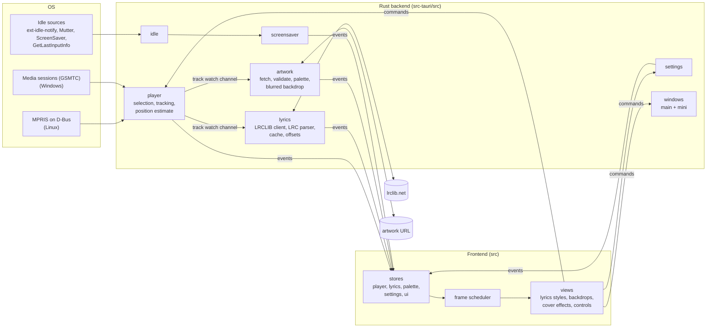

# Architecture

Sahne is a [Tauri 2](https://tauri.app) application: a Rust backend that
watches the system's media players, fetches lyrics and artwork, and pushes
events to a [Svelte 5](https://svelte.dev) frontend that renders them in a
webview (WebKitGTK on Linux, WebView2 on Windows).

## Backend services

Each service is created in `lib.rs::run`, stored in Tauri's state, and
started in `setup`.

| Module                 | Responsibility                                                                                                                                                                                                                                                                                                                                                                                            |
| ---------------------- | --------------------------------------------------------------------------------------------------------------------------------------------------------------------------------------------------------------------------------------------------------------------------------------------------------------------------------------------------------------------------------------------------------- |
| `player/`              | Finds the player to follow (`select.rs`: the preferred one, else Spotify, else the first that is playing, else any), reads its metadata and playback state (`linux.rs` + `mpris.rs` over D-Bus, `gsmtc.rs` on Windows), and keeps a position estimate between updates (`tracker.rs`, including the fallback for players that always report position 0). Publishes the current track on a `watch` channel. |
| `lyrics/`              | For each track: cache lookup, then LRCLIB (`lrclib.rs`: `get-cached`, `search`, `get`, with rate-limit and outage back-off), title normalisation (`normalize.rs`) and LRC parsing (`lrc.rs`). Keeps per-track offsets.                                                                                                                                                                                    |
| `artwork/`             | Fetches and validates the cover (see `SECURITY.md`), extracts a palette (OKLab k-means, `palette.rs`) and pre-renders a blurred backdrop.                                                                                                                                                                                                                                                                 |
| `idle.rs`, `idle/`     | System idle detection on a dedicated thread; publishes "idle" on a `watch` channel.                                                                                                                                                                                                                                                                                                                       |
| `screensaver.rs`       | While music plays and the system is idle, brings the main window forward in fullscreen; restores the previous window state on input. Optionally inhibits screen blanking.                                                                                                                                                                                                                                 |
| `settings.rs`          | Loads `settings.json` leniently (one bad field resets only that field), applies patches from the frontend, saves atomically.                                                                                                                                                                                                                                                                              |
| `windows.rs`           | Creates, places and destroys the mini window.                                                                                                                                                                                                                                                                                                                                                             |
| `cache.rs`, `paths.rs` | Cache sizing, pruning and clearing; XDG/Known-Folder paths; atomic file writes.                                                                                                                                                                                                                                                                                                                           |
| `events.rs`            | Event names and payload types shared with the frontend.                                                                                                                                                                                                                                                                                                                                                   |

## Event contract

The backend emits these events to all windows. Payload types are defined in
`src-tauri/src/events.rs` and mirrored in `src/lib/types.ts`; the
`ts_contract` test serialises sample payloads so a field rename on one side
fails the build.

| Event                 | Payload             | When                                                         |
| --------------------- | ------------------- | ------------------------------------------------------------ |
| `track-changed`       | `TrackInfo \| null` | A new track starts, or the player has no track               |
| `playback-state`      | `PlaybackState`     | Playing, paused or stopped changes                           |
| `position-sync`       | `PositionSync`      | After seeks and periodically; the frontend interpolates      |
| `volume-changed`      | `number \| null`    | The player's volume changes (null where it is not available) |
| `player-disconnected` | none                | The followed player went away                                |
| `lyrics-loaded`       | `LyricsLoaded`      | Lyrics state for the current track (loading, synced, …)      |
| `palette-changed`     | `PaletteChanged`    | Artwork, backdrop and palette for the current track          |
| `settings-changed`    | `Settings`          | Settings were saved (by any window)                          |
| `screensaver`         | `boolean`           | Screensaver mode starts or ends                              |

The frontend calls the commands registered in `lib.rs` (`get_state`,
`play_pause`, `seek`, `get_lyrics`, `update_settings`, `set_mini_mode`, …).
On startup each window pulls the current state with the `get_*` commands, so
it never depends on having seen earlier events.

## Threading model

- **Async runtime.** Player tracking (Linux), lyrics, artwork and the
  screensaver run as tasks on Tauri's Tokio runtime. File I/O and other
  blocking work (settings saves, cache pruning, image decoding) go through
  `spawn_blocking`, never the main thread.
- **Dedicated threads.** The Windows media-session loop (WinRT) and the idle
  monitor each run on their own named thread.
- **One job per service.** Lyrics and artwork keep at most one job in flight
  (`sync::Inflight`); a track change aborts the previous job, so rapid
  skipping never piles up requests.
- **Shared state.** Small `Mutex`es guarded by `sync::lock`, which recovers
  from poisoning; cross-service notifications use `watch` channels and
  `Notify`.
- **Frontend.** One shared `requestAnimationFrame` loop (`src/lib/frames.ts`)
  drives every animation. Components register clients that report whether
  they still need frames; the loop stops when none do and while the window is
  hidden, so a paused player draws nothing.

## Cache and data layout

| Path (Linux)                    | Path (Windows)                                            | Contents                                                       |
| ------------------------------- | --------------------------------------------------------- | -------------------------------------------------------------- |
| `~/.config/sahne/settings.json` | `%APPDATA%\sahne\config\settings.json`                    | Settings (a `.bak` copy is kept if the file was unreadable)    |
| `~/.config/sahne/offsets.json`  | `%APPDATA%\sahne\config\offsets.json`                     | Per-track lyric offsets                                        |
| `~/.cache/sahne/lyrics/`        | `%LOCALAPPDATA%\sahne\cache\lyrics\`                      | `<hash>.json` per track; "not found" is retried after 24 hours |
| `~/.cache/sahne/art/`           | `%LOCALAPPDATA%\sahne\cache\art\`                         | `<hash>.img` artwork and `<hash>-bg2.png` blurred backdrop     |
| –                               | `%LOCALAPPDATA%\io.github.tosyaliemir.Sahne\session-art\` | Thumbnails read from Windows media sessions                    |

Hashes are 64-bit FNV-1a (`paths::stable_hash`): of `artist|title|seconds`
for lyrics and of the URL (or the file content for local files) for artwork.
The lyrics cache is capped at 20 MB and the artwork cache at 200 MB; the
least recently used files are pruned at startup. Settings → Window → Cache
shows the size and clears it.
